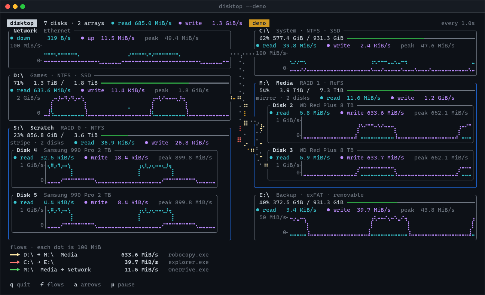
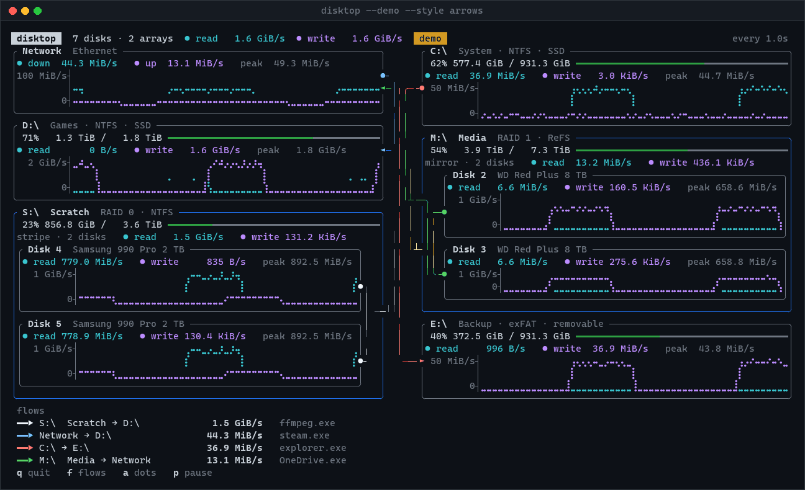

<h1 align="center">disktop</h1>

<p align="center">
  A <code>top</code>-style terminal monitor for your drives that shows where data is going.
</p>

<p align="center">
  <a href="https://github.com/0mnicy/disktop/releases/latest"></a>
  <a href="https://github.com/0mnicy/disktop/actions/workflows/ci.yml"></a>
  
  
  <a href="#license"></a>
</p>

<p align="center">
  
</p>

Every drive gets a panel with a capacity bar and a live graph of reads and
writes. RAID arrays get one panel with a graph for each disk inside them.
When a program copies files from one drive to another, disktop draws it as
dots marching from one panel to the other and names the program. Downloads
and uploads run to and from a Network panel the same way.

- **Live graphs** of every drive's reads and writes, and of the network.
- **Arrays as one panel**, with a graph per member disk. On Linux, btrfs
  filesystems that span several disks are found and grouped this way.
- **Copies, downloads and uploads**, traced to the program doing them: from
  `/proc` on Linux, and from Event Tracing for Windows.
- **Sizes at a glance**: every dot stands for the same amount of data, so a
  busier copy has more dots.

## Install

### Prebuilt binaries

Every [release](https://github.com/0mnicy/disktop/releases/latest) has
archives for Windows and Linux, on x86-64 and ARM64. The Linux builds are
static, so they run on any distribution.

On Linux:

```sh
curl -sSL https://github.com/0mnicy/disktop/releases/latest/download/disktop-x86_64-unknown-linux-musl.tar.gz | tar xz
sudo install disktop-x86_64-unknown-linux-musl/disktop /usr/local/bin/
```

On Windows, in PowerShell:

```powershell
Invoke-WebRequest https://github.com/0mnicy/disktop/releases/latest/download/disktop-x86_64-pc-windows-msvc.zip -OutFile disktop.zip
Expand-Archive disktop.zip -DestinationPath .
.\disktop-x86_64-pc-windows-msvc\disktop.exe
```

For ARM64, swap `x86_64` for `aarch64`. Each release lists SHA-256
checksums, and its archives carry [build provenance](https://docs.github.com/en/actions/how-tos/secure-your-work/use-artifact-attestations/use-artifact-attestations)
you can check with `gh attestation verify <archive> --repo 0mnicy/disktop`.

### From source

You need [Rust](https://rustup.rs) 1.95 or newer.

```sh
cargo install --git https://github.com/0mnicy/disktop
```

Or build from a clone:

```sh
git clone https://github.com/0mnicy/disktop
cd disktop
cargo run --release
```

## Usage

```sh
disktop                 # sample once a second
disktop --interval 250  # sample every 250 ms (minimum 100)
disktop --demo          # made-up arrays and copies, to see the flow view
disktop --style arrows  # draw flows as arrows instead of dots
disktop --dot-size 1M   # make every flow dot stand for 1 MiB
disktop --fps 10        # fewer animation frames, for slow terminals
```

To see every program's copies, run it with `sudo` on Linux, or from an
Administrator terminal on Windows. Without that, the drive panels and graphs
still work, and the footer says what's missing.

| Key | Action |
| --- | --- |
| <kbd>f</kbd> | Show or hide flows |
| <kbd>a</kbd> | Switch between dots and arrows |
| <kbd>p</kbd> or <kbd>Space</kbd> | Pause |
| <kbd>q</kbd>, <kbd>Esc</kbd> or <kbd>Ctrl</kbd>+<kbd>C</kbd> | Quit |

## Reading the flow view

Each copy between drives gets its own color, a dim dotted track showing its
route, and bright dots moving along it from source to destination. Each dot
trails a short dim tail, so it points the way the data is going. Every flow
leaves and enters a panel at its own point and runs in its own lane in the
channel between the columns, so streams don't pile on top of each other.

Every dot stands for the same amount of data across all flows, like the
scale on a map, and the list under the panels says how much (`each dot is
100 MiB`). Dots all move at the same speed, so a flow with twice as many
dots is moving twice as much data. The amount is a round size picked so the
busiest flow shows a readable number of dots; it only changes when the
busiest flow speeds up or slows down a lot. Use `--dot-size` to fix it.

Inside an array, each dot lands on as many disks as the array keeps copies:
every disk for a classic mirror, two neighbouring disks at a time for btrfs
RAID 1 or RAID 10, and one disk at a time for a stripe. When there isn't
room for a box per disk, member disks are drawn as compact rows.

With `--style arrows`, or after pressing <kbd>a</kbd>, each flow is drawn as
a dashed arrow instead: a line of dashes from a dot where the data leaves to
an arrowhead where it arrives. The dashes march toward the arrowhead, every
flow at the same steady speed, and each dash is bright at the front and dim
at the back. How fast each flow is moving is in the list under the panels.

<p align="center">
  
</p>

## How flows are found

<details>
<summary><strong>On Linux</strong>, from <code>/proc</code></summary>

<br>

Every sample, disktop reads each process's storage I/O counters from
`/proc`. A process that both read and wrote is a possible copy, so its open
files are checked: which ones it opened for reading and for writing, and
which drive each one is on. A process reading files on one drive and
writing files on another is drawn as a flow between them, at the smaller of
its read and write rates, and labeled with the process name. Files are
traced to a drive through the process's own mount table, so programs in
containers are covered too.

Downloads work the same way. The **Network** panel shows data in and out
across the machine's hardware network interfaces. When a process writes to
a drive more than it read from other drives, while connected to another
machine, the rest came from the network, and it's drawn as a flow from the
Network panel to that drive. It's never bigger than what the process's
network actually received (its container's own interface, or the
machine's), so a program writing its own database or logs isn't mistaken
for a download. Uploads are the same in reverse: a process reading a drive
more than it wrote to other drives, capped at what its network sent, is a
flow from that drive to the Network panel, such as a media server
streaming to a TV. A sync program sending and receiving on the same
drive shows both.

Without root, only your own processes can be inspected; the footer says so.
Flows under 512 KiB/s are left out, and so is a process reading and writing
the same drive, which is usually a database or a log rather than a copy.

</details>

<details>
<summary><strong>On Windows</strong>, from Event Tracing for Windows</summary>

<br>

disktop starts an Event Tracing for Windows (ETW) session that watches the
kernel's file and network events. Every read and write names the file and
the process doing it, so disktop adds up how much each process read from
and wrote to each drive, and how much it received and sent over the network
to other machines. That is turned into copies, downloads and uploads the
same way as on Linux. Files on network shares count as the Network panel.
Windows 11 does the writing half of a copy in the kernel, so that I/O is
counted for the program that opened the file.

Windows hands trace events over in batches, some a second after the data
moved, so disktop counts bytes by when they actually moved. Flows on
Windows show up about a second and a half late, but at a steady rate.

ETW needs Administrator. The Network panel counts only hardware adapters
that are connected, leaving out virtual ones such as Hyper-V and VPNs.

</details>

## Platforms

| | Linux | Windows | macOS |
| --- | :-: | :-: | :-: |
| Drive panels and graphs | ✓ | ✓ | ✓ |
| Network panel | ✓ | ✓ | |
| Copies, downloads and uploads | ✓ (all processes with `sudo`) | ✓ (as Administrator) | |
| Arrays | multi-disk btrfs | | |

Drive stats come from [sysinfo](https://crates.io/crates/sysinfo). On Linux,
multi-disk btrfs filesystems and per-disk I/O are read from `/sys` and
`/proc/diskstats`, none of which needs root. Tested on Windows 11 and
Ubuntu 24.04. Elsewhere, `--demo` shows the flow view with made-up data.

## Status and roadmap

disktop is early, and the flow view is the newest part. Next up:

- Detect more arrays: Storage Spaces on Windows; md, LVM and ZFS on Linux
- Detect real flows on macOS
- Focus mode to highlight one flow and dim the rest
- Per-process view of who is hitting each drive
- Keyboard controls for interval, layout and hiding drives

## Contributing

Issues and pull requests are welcome. [CONTRIBUTING.md](CONTRIBUTING.md)
covers building, testing, the diagnostic tests for checking flows on a real
machine, and how to re-record the animations above.

## License

Licensed under either of

- Apache License, Version 2.0 ([LICENSE-APACHE](LICENSE-APACHE))
- MIT license ([LICENSE-MIT](LICENSE-MIT))

at your option.

Unless you explicitly state otherwise, any contribution intentionally submitted
for inclusion in the work by you, as defined in the Apache-2.0 license, shall be
dual licensed as above, without any additional terms or conditions.
